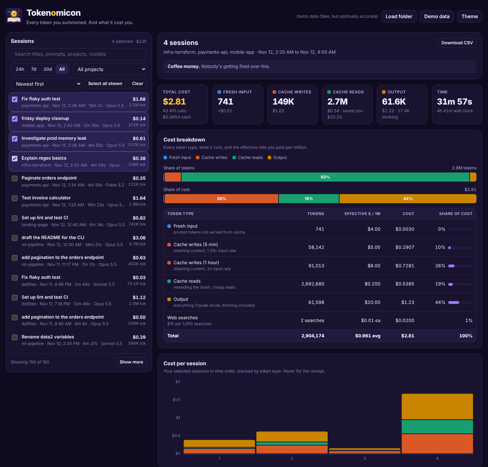

<picture>
  <source media="(prefers-color-scheme: dark)" srcset="assets/tokenomicon-wordmark-dark.svg">
  
</picture>

*Every token you summoned. And what it cost you.*

Scan your Claude Code sessions, pick one or a bunch, and get an itemized bill: fresh input, cache writes, cache reads, output, cost per model, cost per API call, and how long it all took. It reads the transcripts Claude Code already writes to `~/.claude/projects`, and nothing leaves your machine.

## Run it

```bash
python3 tokenomicon.py --serve
```

That scans every transcript and opens http://localhost:8787. Refresh the page to rescan, and your selection sticks. Keep `tokenomicon.py` and `tokenomicon.html` in the same folder.

Rather have a file? `python3 tokenomicon.py` writes `tokenomicon-report.html` with everything baked in and opens it.

Don't want to run a script? Open `tokenomicon.html` and hit **Load folder** (pick `~/.claude/projects`; on a Mac, `Cmd+Shift+.` shows hidden folders), drag the folder onto the page, or click **Demo data**.

Want it on your phone too? `python3 tokenomicon.py --serve --host 0.0.0.0` makes it reachable from other devices on your Wi-Fi. Heads up: that means anyone on the same network can see your spend and your prompts.

Flags: `--dir PATH` (scan somewhere else, repeatable), `--out FILE`, `--no-open`, `--serve`, `--port N` (default 8787), `--host ADDR` (default 127.0.0.1).



## How it works

1. **Pick sessions.** The left panel lists every session it found under the same name Claude Code's `/resume` shows (your `/rename` title, else Claude's auto-generated title, else the first prompt), plus project, date, time spent, cost and token count. Hover a name to see the first prompt. Search, filter by project or date (24h / 7d / 30d / All), sort by newest, priciest, most tokens or longest, and tick as many as you like. "Select all shown" grabs everything that matches your filter.
2. **Read the bill.** The right panel breaks down whatever you picked:
   - Total cost, fresh input, cache writes, cache reads, output (with thinking tokens called out) and time
   - Share of tokens vs share of cost, side by side, so you can see cache reads being 96% of the tokens and a fraction of the money
   - A table of every token type with its count, the effective rate you paid per million, its cost and its share
   - Cost per API call for one session, or cost per session when you pick several, stacked by token type with hover receipts
   - Totals per model, and a per-session table you can prune
3. **Take it with you.** Download CSV exports the selected sessions with every token and dollar column.

## How the numbers work

- **Cost** uses Anthropic API list prices (the `PRICING` table at the top of the script in `tokenomicon.html`). Cache writes are billed at 1.25x input (5 min TTL) or 2x (1 hour TTL), cache reads at each model's cache rate, web searches at $10 per thousand, and fast mode at 2x. On a Pro or Max subscription this is what the same usage would cost on the API.
- **Duplicates**: Claude Code writes one line per content block, all carrying the same usage. Tokenomicon counts each API message once.
- **Subagents** roll up into their parent session.
- **Active time** adds up the gaps between events and skips any gap over 5 minutes. **Wall** is first event to last.

## Files

| File | What it is |
| --- | --- |
| `tokenomicon.html` | The dashboard (a single self-contained file) |
| `tokenomicon.py` | Collector that builds a report with your data baked in |
| `assets/tokenomicon-logo.svg` | App icon |
| `assets/tokenomicon-wordmark.svg` / `-dark.svg` | Logo and name, for light and dark backgrounds |
| `assets/preview.png` | Screenshot with four demo sessions selected |

Generated `tokenomicon-report.html` files hold your own usage data, so `.gitignore` keeps them out of the repo.
